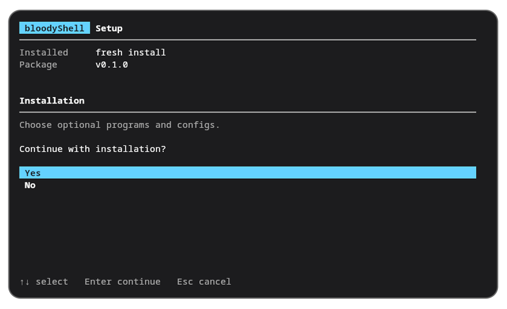
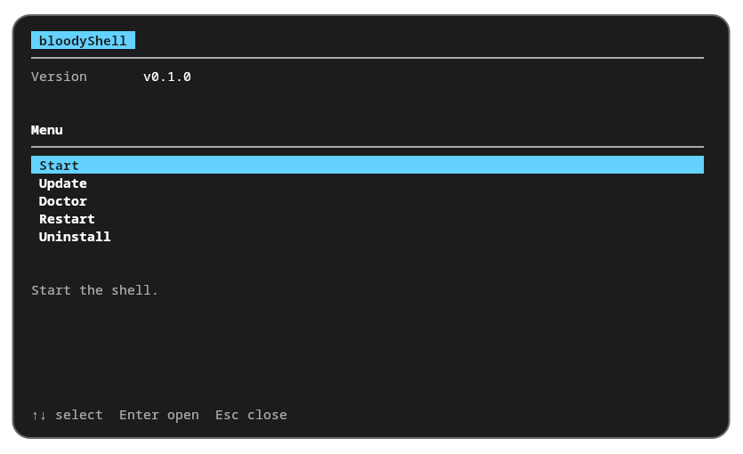
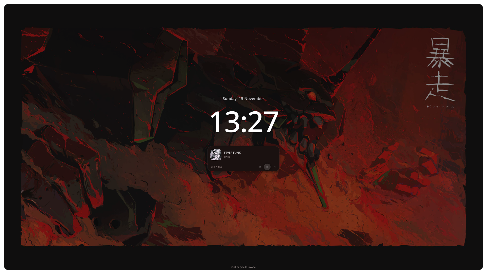

<h1 align="center">CHANGELOG</h1>

    All notable changes to bloodyShell documented in this file.
     
    The format is based on Keep a Changelog.

## [0.1.0] - 2026-11-15

    Redesign of the installer, CLI tool, interface improvement and optimization.

    
    
     
    <b>Setup</b> wizard &nbsp;&nbsp;•&nbsp;&nbsp; <b>CLI</b> instrument

    
     
    <b>Lock</b> screen

### Added

- **UI:** Added a recording indicator to the Dynamic Island.
- **UI:** Added application icons to the applications list.
- **UI:** Added context menus for applications in the applications list.
- **UI:** Introduced the `Comfortaa` font for the shell title.
- **Settings:** Added action popups.
- **Settings:** Added the virtual keyboard.
- **Settings:** Added support for `Easy Effects`.
- **Settings:** Added opacity controls for the desktop equalizer.
- **Settings:** Added options to configure default applications for keyboard shortcuts, including the web browser, terminal, and file manager.
- **Settings:** Introduced a dedicated keyboard shortcuts configuration page.
- **Settings:** Added the ability to import compositor configurations, dotfiles, login screen configurations, and wallpapers directly from the Updates page.
- **Settings:** Added mouse configuration options to the Devices page.
- **Settings:** Added current version changelog foldout in the Updates page.
- **Settings:** Introduced a dedicated Components page for configuring screenshot and login screen settings.
- **Other:** Added support for video wallpapers.
- **Other:** Added customizable wallpaper transition animations.
- **Other:** Added support for `.jfif` images as user profile pictures.

### Changed

- **Core:** Replaced the `greetd` display manager with `SDDM`.
- **Core** The wallpaper collection has been moved to a separate repository on github.
- **UI:** Updated frame behavior to remain visible above fullscreen windows and automatically hide with an animation when a window enters fullscreen mode.
- **UI:** Refreshed the lock screen appearance and animations.
- **UI:** Refreshed the screenshot overlay for a more consistent visual experience.
- **UI:** Redesigned installation process.
- **UI:** Redesigned menus with a sidebar-based layout.
- **UI:** Redesigned the wallpaper overlay with a more compact layout.
- **UI:** Updated the wallpaper overlay to appear above existing overlays without closing or replacing them.
- **UI:** Updated the media menu to replace the Dynamic Island content when opened, preventing duplicate track information and album artwork.
- **Settings:** Moved dynamic island settings to foldout in bar page.
- **Settings:** Reorganized dependencies into two categories: required and optional.
- **Settings:** Changed the default wallpaper directory to `~/Pictures/Wallpapers`.
- **Settings:** Separated power profile configurations into battery-powered and plugged-in modes.
- **Settings:** Repositioned the display layout section for improved accessibility.

### Fixed

- **UI:** Fixed an issue where menu content would not appear when the bar was positioned anywhere other than the top of the screen.
- **UI:** Fixed sidebar positioning to correctly follow the bar's location instead of remaining anchored to the top corners.
- **UI:** Fixed workspace tracking so the bar and dock independently detect empty workspaces on their respective displays rather than the currently focused display.
- **UI:** Corrected inconsistent sizing across various interface elements.
- **UI:** Fixed an issue where the desktop equalizer was clipped at half the screen height.
- **UI:** Fixed an issue that caused the settings navigation list to scroll to the bottom whenever Settings was opened.
- **UI:** Updated equalizer calculations to use available width, ensuring proper rendering on vertically oriented displays.
- **Other:** Fixed a lock screen initialization issue by ensuring the wallpaper backdrop finishes loading before the lock screen is displayed.
- **Other:** Fixed an issue where system tray icons did not respond to right-click events.
- **Other:** Fixed a potential `quickshell` crash when opening an overlay from another overlay instead of the main overlay.

## [0.0.2] - 2026-11-09

Sidebars, the Dynamic Island, a built-in screenshot tool and other.

### Added

- **UI:** Added left and right sidebars with quick controls.
- **Settings:** Added settings for notifications.
- **Settings:** Added settings for applications autostart.
- **Settings:** Added option for auto-update on new version.
- **Features:** Added built-in screenshot overlay with region selection.
- **Features:** Wi-Fi credentials dialog supporting password and enterprise (PEAP/TTLS) authentication.

### Changed

- **Core:** Restructured the codebase - UI moved to `modules/ui/`, shared components to `modules/common/`, animations to `modules/animations/`, sources to `modules/src/`.
- **Core:** Reworked frame calculation and rendering.
- **Core:** The window switcher is now built into the shell's overlay system.
- **Core:** `configs/` renamed to `dots/`.
- **UI:** Rebuilt the bar and its menus on the new shared menu components.
- **UI:** Refined the visual styling of the Bar, Dock, and Dynamic Island (formerly On-Screen Display) components.
- **UI:** Improved the layout and functionality of menus.
- **UI:** Renamed the On-Screen Display (OSD) component to "Dynamic Island".

### Removed

- **Bar:** The standalone system menu and the old media/status bar widgets.

## [0.0.1] - 2026-11-03

Initial release