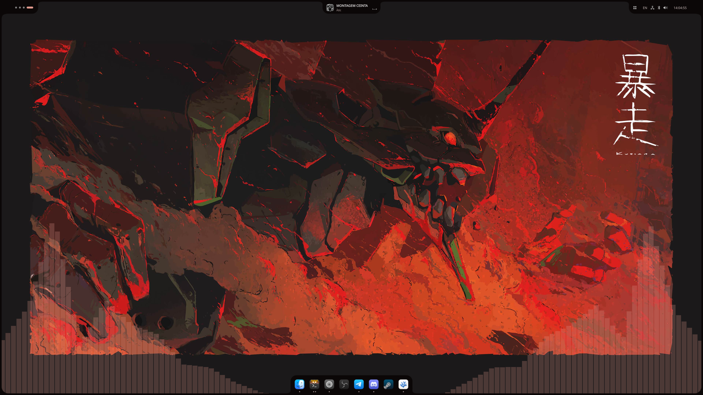
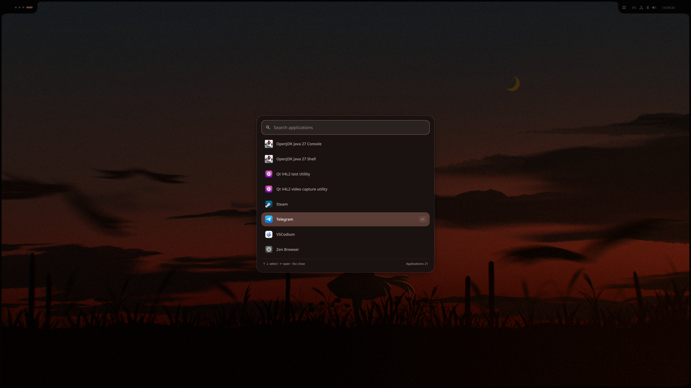
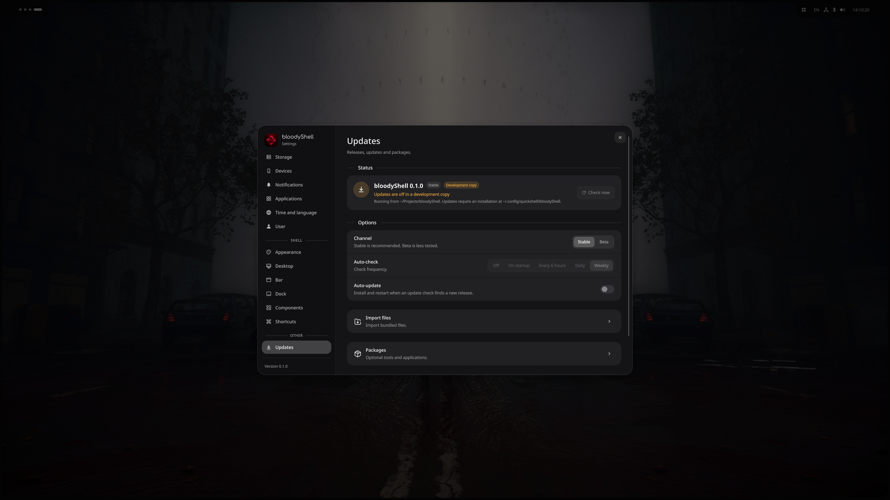
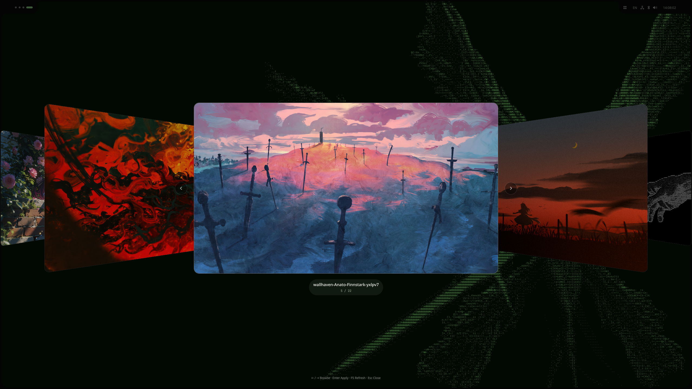

<p align="center">
  
</p>

<h1 align="center">bloodyShell</h1>

<p align="center">
    <b>A desktop shell for <a href="https://github.com/niri-wm/niri">niri</a>, built with Quickshell</b>
</p>

<p align="center">
  
  
</p>

<p align="center">
  <a href="https://github.com/bloodykgrapes/bloodyShell/wiki/INSTALL">Install</a>
  &bull;
  <a href="https://github.com/bloodykgrapes/bloodyShell/wiki/KEYBINDS">Keybinds</a>
  &bull;
  <a href="https://discord.gg/">Discord</a>
</p>

<p align="center">
  <sub>
    English
    &bull;
    <a href="docs/readme/README.ru.md">Русский</a>
    &bull;
    <a href="docs/readme/README.fr.md">Français</a>
    &bull;
    <a href="docs/readme/README.de.md">Deutsch</a>
    &bull;
    <a href="docs/readme/README.ja.md">日本語</a>
  </sub>
</p>

---

> [!WARNING]
> I cannot guarantee the proper operation of untested distributions or compositors. Use them at your own risk. However, if you are able to fully test the functionality of the software on your system and provide feedback, that would be greatly appreciated.

At present, I am physically unable to implement support for additional compositors.
bloodyShell is currently built specifically for niri.
Support for other popular Wayland compositors is planned for future releases.

## Screenshots

<p align="center">
  
  
  
  
</p>

## Installation

Arch, Debian, Fedora, Ubuntu:

```bash
git clone https://github.com/bloodykgrapes/bloodyShell.git
cd bloodyShell
./setup install
```

Setup installs the `bloodyShell` command.

```bash
bloodyShell             # interactive menu
bloodyShell start       # launch shell
bloodyShell restart     # reload shell
bloodyShell update      # check and install update
bloodyShell doctor      # diagnostics
```

See the [installation guide](https://github.com/bloodykgrapes/bloodyShell/wiki/INSTALL) for details.

## Documentation

| Page | Description |
| :--- | :---------- |
|[ARCHITECTURE](https://github.com/bloodykgrapes/bloodyShell/wiki/ARCHITECTURE)|Code structure and architecture|
|[INSTALL](https://github.com/bloodykgrapes/bloodyShell/wiki/INSTALL)|Installation manual|
|[KEYBINDS](https://github.com/bloodykgrapes/bloodyShell/wiki/KEYBINDS)|All the keybindings|
|[PACKAGES](https://github.com/bloodykgrapes/bloodyShell/wiki/PACKAGES)|Project dependencies|

## Credits

- [**Quickshell**](https://quickshell.outfoxxed.me/): the framework
- [**niri**](https://github.com/niri-wm/niri): the compositor
- [**iNiR**](https://github.com/snowarch/iNiR): where the inspiration came from

---

<p align="center">
  <a href="https://github.com/bloodykgrapes/bloodyShell/graphs/contributors">Contributors</a>
  &bull;
  <a href="CHANGELOG.md">Changelog</a>
  &bull;
  <a href="LICENSE">License</a>
</p>