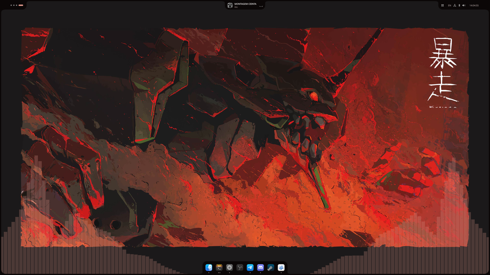
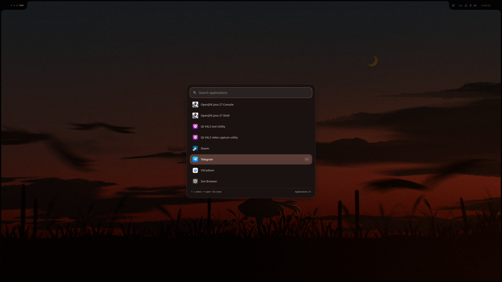
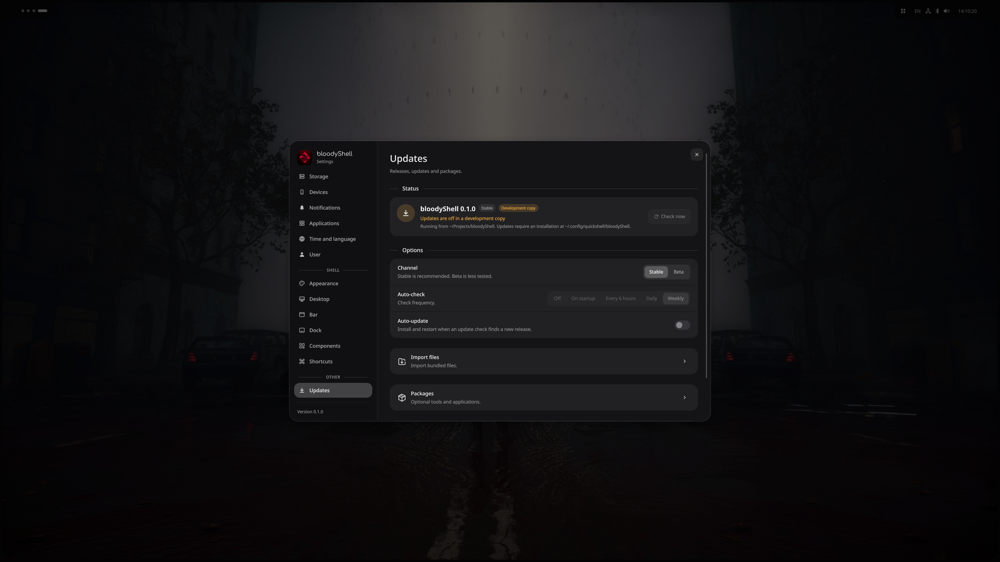
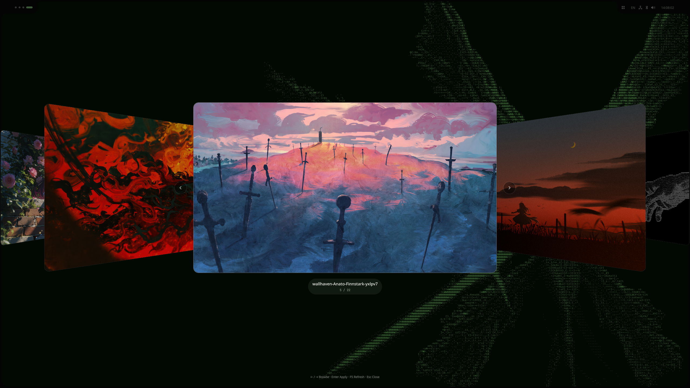

<p align="center">
  
</p>

<h1 align="center">bloodyShell</h1>

<p align="center">
    <b>Eine Desktop-Shell für <a href="https://github.com/niri-wm/niri">niri</a>, gebaut mit Quickshell</b>
</p>

<p align="center">
  
  
</p>

<p align="center">
  <sub>
    <a href="../../README.md">English</a>
    &bull;
    <a href="README.ru.md">Русский</a>
    &bull;
    <a href="README.fr.md">Français</a>
    &bull;
    Deutsch
    &bull;
    <a href="README.ja.md">日本語</a>
  </sub>
</p>

---

> [!WARNING]
> Ich kann die einwandfreie Funktion auf ungetesteten Distributionen oder Compositors nicht garantieren. Die Nutzung erfolgt auf eigene Gefahr. Wenn Sie jedoch die Funktionalität der Software auf Ihrem System vollständig testen und Rückmeldung geben können, wäre das sehr willkommen.

Derzeit ist es mir nicht möglich, die Unterstützung zusätzlicher Compositors zu implementieren.
bloodyShell ist derzeit speziell für niri entwickelt.
Die Unterstützung weiterer verbreiteter Wayland-Compositors ist für zukünftige Versionen geplant.

## Screenshots

<p align="center">
  
  
  
  
</p>

## Installation

Arch, Debian, Fedora, Ubuntu:

```bash
git clone https://github.com/bloodykgrapes/bloodyShell.git
cd bloodyShell
./setup install
```

Setup installiert den Befehl `bloodyShell`.

```bash
bloodyShell             # interaktives Menü
bloodyShell start       # Shell starten
bloodyShell restart     # Shell neu laden
bloodyShell update      # Updates prüfen und installieren
bloodyShell doctor      # Diagnose
```

Details finden Sie in der [Installationsanleitung](https://github.com/bloodykgrapes/bloodyShell/wiki/INSTALL).

## Dokumentation

| Seite | Beschreibung |
| :--- | :---------- |
|[ARCHITECTURE](https://github.com/bloodykgrapes/bloodyShell/wiki/ARCHITECTURE)|Codestruktur und Architektur|
|[INSTALL](https://github.com/bloodykgrapes/bloodyShell/wiki/INSTALL)|Installationsanleitung|
|[KEYBINDS](https://github.com/bloodykgrapes/bloodyShell/wiki/KEYBINDS)|Alle Tastenkürzel|
|[PACKAGES](https://github.com/bloodykgrapes/bloodyShell/wiki/PACKAGES)|Projektabhängigkeiten|

## Danksagungen

- [**Quickshell**](https://quickshell.outfoxxed.me/): das Framework
- [**niri**](https://github.com/niri-wm/niri): der Compositor
- [**iNiR**](https://github.com/snowarch/iNiR): die Inspirationsquelle

---

<p align="center">
  <a href="https://github.com/bloodykgrapes/bloodyShell/graphs/contributors">Mitwirkende</a>
  &bull;
  <a href="../../CHANGELOG.md">Änderungsprotokoll</a>
  &bull;
  <a href="../../LICENSE">Lizenz</a>
</p>