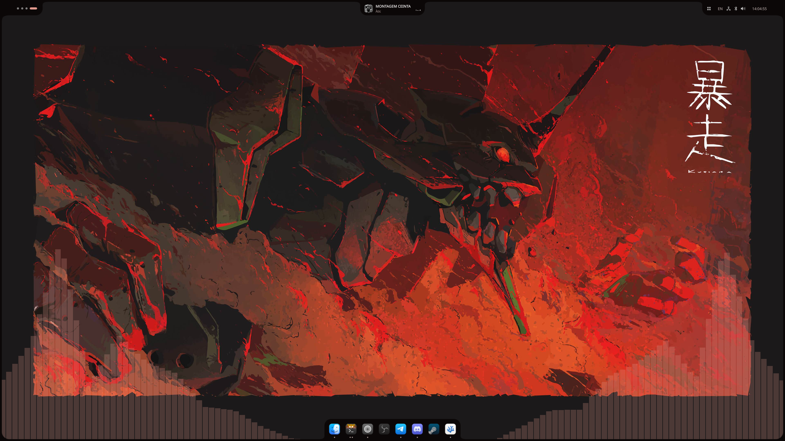
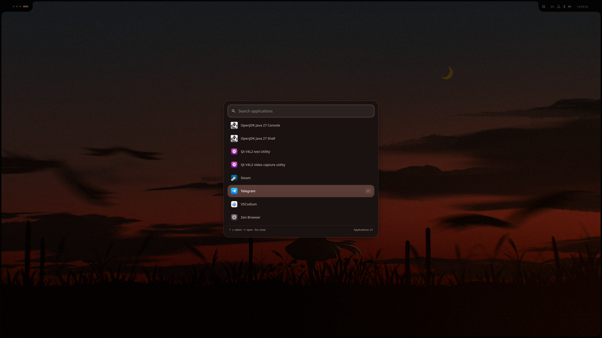
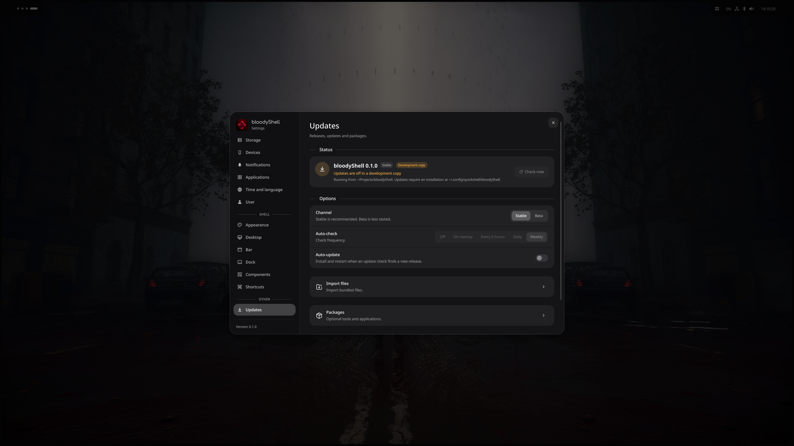
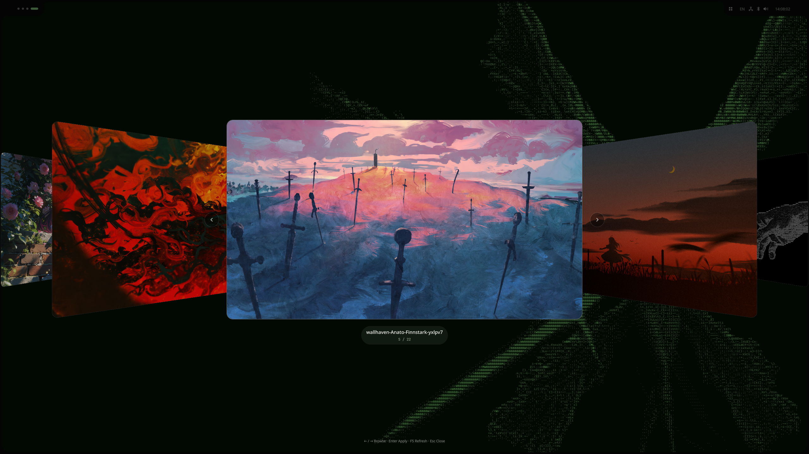

<p align="center">
  
</p>

<h1 align="center">bloodyShell</h1>

<p align="center">
    <b>Un shell de bureau pour <a href="https://github.com/niri-wm/niri">niri</a>, construit avec Quickshell</b>
</p>

<p align="center">
  
  
</p>

<p align="center">
  <sub>
    <a href="../../README.md">English</a>
    &bull;
    <a href="README.ru.md">Русский</a>
    &bull;
    Français
    &bull;
    <a href="README.de.md">Deutsch</a>
    &bull;
    <a href="README.ja.md">日本語</a>
  </sub>
</p>

---

> [!WARNING]
> Je ne peux pas garantir le bon fonctionnement sur des distributions ou des compositeurs non testés. Utilisez-les à vos propres risques. Cependant, si vous pouvez tester entièrement les fonctionnalités du logiciel sur votre système et faire un retour, ce serait très apprécié.

À l'heure actuelle, je ne suis pas en mesure d'implémenter la prise en charge de compositeurs supplémentaires.
bloodyShell est actuellement conçu spécifiquement pour niri.
La prise en charge d'autres compositeurs Wayland populaires est prévue pour les prochaines versions.

## Captures d'écran

<p align="center">
  
  
  
  
</p>

## Installation

Arch, Debian, Fedora, Ubuntu :

```bash
git clone https://github.com/bloodykgrapes/bloodyShell.git
cd bloodyShell
./setup install
```

Setup installe la commande `bloodyShell`.

```bash
bloodyShell             # menu interactif
bloodyShell start       # lancer le shell
bloodyShell restart     # recharger le shell
bloodyShell update      # vérifier et installer les mises à jour
bloodyShell doctor      # diagnostics
```

Consultez le [guide d'installation](https://github.com/bloodykgrapes/bloodyShell/wiki/INSTALL) pour plus de détails.

## Documentation

| Page | Description |
| :--- | :---------- |
|[ARCHITECTURE](https://github.com/bloodykgrapes/bloodyShell/wiki/ARCHITECTURE)|Structure du code et architecture|
|[INSTALL](https://github.com/bloodykgrapes/bloodyShell/wiki/INSTALL)|Manuel d'installation|
|[KEYBINDS](https://github.com/bloodykgrapes/bloodyShell/wiki/KEYBINDS)|Tous les raccourcis clavier|
|[PACKAGES](https://github.com/bloodykgrapes/bloodyShell/wiki/PACKAGES)|Dépendances du projet|

## Crédits

- [**Quickshell**](https://quickshell.outfoxxed.me/): le framework
- [**niri**](https://github.com/niri-wm/niri): le compositeur
- [**iNiR**](https://github.com/snowarch/iNiR): la source d'inspiration

---

<p align="center">
  <a href="https://github.com/bloodykgrapes/bloodyShell/graphs/contributors">Contributeurs</a>
  &bull;
  <a href="../../CHANGELOG.md">Journal des modifications</a>
  &bull;
  <a href="../../LICENSE">Licence</a>
</p>