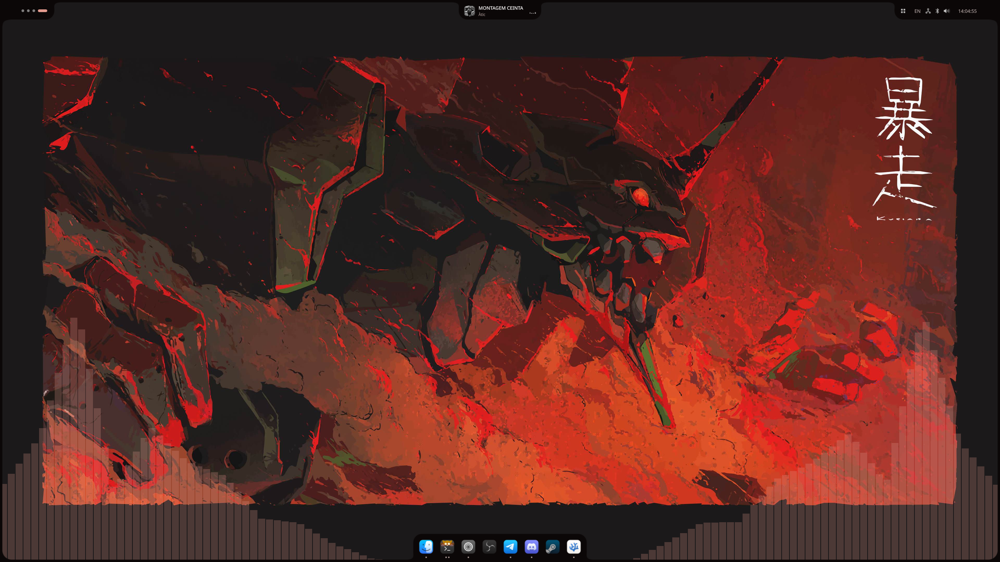
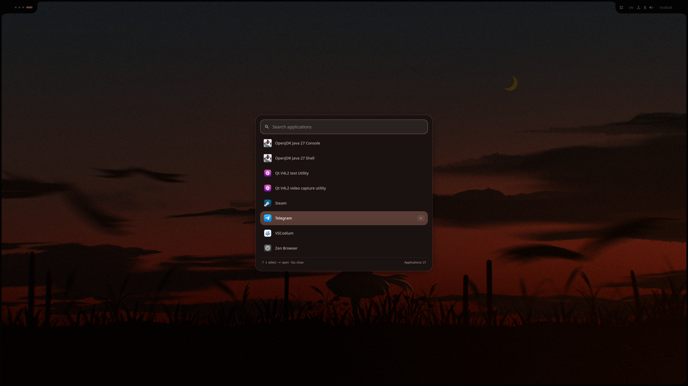
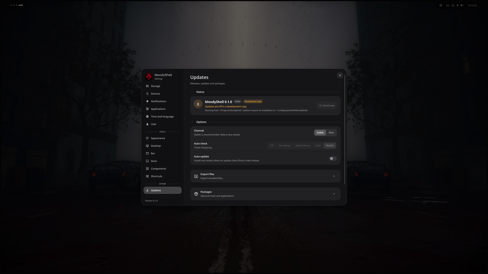

<p align="center">
  
</p>

<h1 align="center">bloodyShell</h1>

<p align="center">
    <b>Quickshell で構築された <a href="https://github.com/niri-wm/niri">niri</a> 用デスクトップシェル</b>
</p>

<p align="center">
  
  
</p>

<p align="center">
  <a href="https://github.com/bloodykgrapes/bloodyShell/wiki/INSTALL">インストール</a>
  &bull;
  <a href="https://github.com/bloodykgrapes/bloodyShell/wiki/KEYBINDS">キーバインド</a>
  &bull;
  <a href="https://discord.gg/">Discord</a>
</p>

<p align="center">
  <sub>
    <a href="../../README.md">English</a>
    &bull;
    <a href="README.ru.md">Русский</a>
    &bull;
    <a href="README.fr.md">Français</a>
    &bull;
    <a href="README.de.md">Deutsch</a>
    &bull;
    日本語
  </sub>
</p>

---

> [!WARNING]
> テストされていないディストリビューションやコンポジターでの正常な動作は保証できません。自己責任でご使用ください。ただし、お使いのシステムでソフトウェアの機能を完全にテストし、フィードバックを提供していただける場合は、大変ありがたく思います。

現時点では、追加のコンポジターのサポートを実装する余力がありません。
bloodyShell は現在 niri 専用に構築されています。
他の人気のある Wayland コンポジターのサポートは、将来のリリースで予定されています。

## スクリーンショット

<p align="center">
  
  
  
  
</p>

## インストール

Arch、Debian、Fedora、Ubuntu:

```bash
git clone https://github.com/bloodykgrapes/bloodyShell.git
cd bloodyShell
./setup install
```

Setup は `bloodyShell` コマンドをインストールします。

```bash
bloodyShell             # 対話型メニュー
bloodyShell start       # シェルを起動
bloodyShell restart     # シェルを再読み込み
bloodyShell update      # 更新を確認してインストール
bloodyShell doctor      # 診断
```

詳細は[インストールガイド](https://github.com/bloodykgrapes/bloodyShell/wiki/INSTALL)をご覧ください。

## ドキュメント

| ページ | 説明 |
| :--- | :---------- |
|[ARCHITECTURE](https://github.com/bloodykgrapes/bloodyShell/wiki/ARCHITECTURE)|コード構成とアーキテクチャ|
|[INSTALL](https://github.com/bloodykgrapes/bloodyShell/wiki/INSTALL)|インストールマニュアル|
|[KEYBINDS](https://github.com/bloodykgrapes/bloodyShell/wiki/KEYBINDS)|すべてのキーバインド|
|[PACKAGES](https://github.com/bloodykgrapes/bloodyShell/wiki/PACKAGES)|プロジェクトの依存関係|

## クレジット

- [**Quickshell**](https://quickshell.outfoxxed.me/): フレームワーク
- [**niri**](https://github.com/niri-wm/niri): コンポジター
- [**iNiR**](https://github.com/snowarch/iNiR): 着想の源

---

<p align="center">
  <a href="https://github.com/bloodykgrapes/bloodyShell/graphs/contributors">コントリビューター</a>
  &bull;
  <a href="../../CHANGELOG.md">変更履歴</a>
  &bull;
  <a href="../../LICENSE">ライセンス</a>
</p>