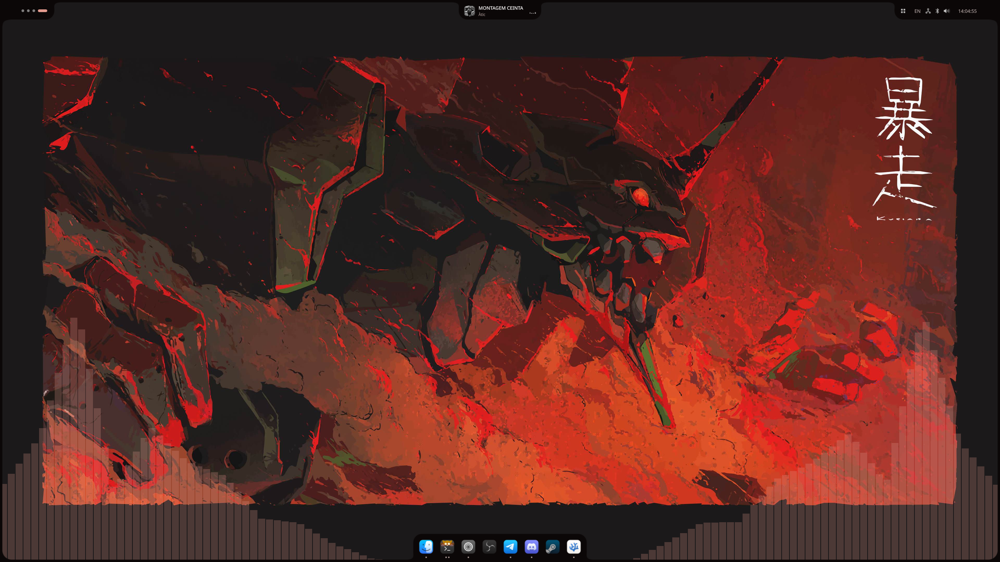
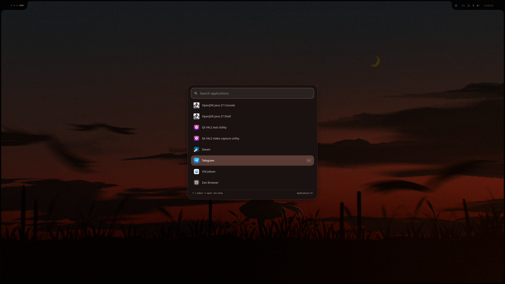
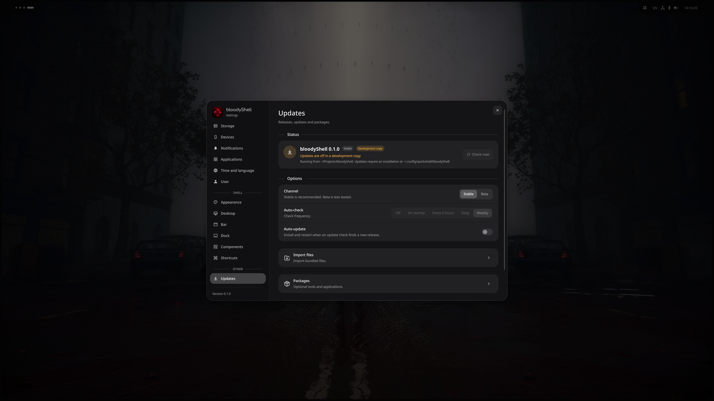
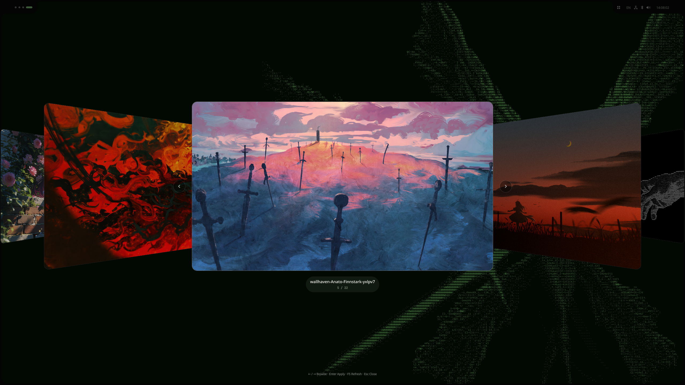

<p align="center">
  
</p>

<h1 align="center">bloodyShell</h1>

<p align="center">
    <b>Оболочка рабочего стола для <a href="https://github.com/niri-wm/niri">niri</a> на базе Quickshell</b>
</p>

<p align="center">
  
  
</p>

<p align="center">
  <a href="https://github.com/bloodykgrapes/bloodyShell/wiki/INSTALL">Установка</a>
  &bull;
  <a href="https://github.com/bloodykgrapes/bloodyShell/wiki/KEYBINDS">Горячие клавиши</a>
  &bull;
  <a href="https://discord.gg/">Discord</a>
</p>

<p align="center">
  <sub>
    <a href="../../README.md">English</a>
    &bull;
    Русский
    &bull;
    <a href="README.fr.md">Français</a>
    &bull;
    <a href="README.de.md">Deutsch</a>
    &bull;
    <a href="README.ja.md">日本語</a>
  </sub>
</p>

---

> [!WARNING]
> Я не могу гарантировать корректную работу на непроверенных дистрибутивах и композиторах. Используйте их на свой страх и риск. Однако, если вы сможете полностью протестировать функциональность программного обеспечения на своей системе и поделиться обратной связью, буду весьма признателен.

В настоящее время я физически не могу реализовать поддержку дополнительных композиторов.
bloodyShell в данный момент создан специально для niri.
Поддержка других популярных Wayland-композиторов планируется в будущих выпусках.

## Скриншоты

<p align="center">
  
  
  
  
</p>

## Установка

Arch, Debian, Fedora, Ubuntu:

```bash
git clone https://github.com/bloodykgrapes/bloodyShell.git
cd bloodyShell
./setup install
```

Setup устанавливает команду `bloodyShell`.

```bash
bloodyShell             # интерактивное меню
bloodyShell start       # запуск оболочки
bloodyShell restart     # перезапуск оболочки
bloodyShell update      # проверка и установка обновлений
bloodyShell doctor      # диагностика
```

Подробности — в [руководстве по установке](https://github.com/bloodykgrapes/bloodyShell/wiki/INSTALL).

## Документация

| Страница | Описание |
| :--- | :---------- |
|[ARCHITECTURE](https://github.com/bloodykgrapes/bloodyShell/wiki/ARCHITECTURE)|Структура кода и архитектура|
|[INSTALL](https://github.com/bloodykgrapes/bloodyShell/wiki/INSTALL)|Руководство по установке|
|[KEYBINDS](https://github.com/bloodykgrapes/bloodyShell/wiki/KEYBINDS)|Все горячие клавиши|
|[PACKAGES](https://github.com/bloodykgrapes/bloodyShell/wiki/PACKAGES)|Зависимости проекта|

## Благодарности

- [**Quickshell**](https://quickshell.outfoxxed.me/): фреймворк
- [**niri**](https://github.com/niri-wm/niri): композитор
- [**iNiR**](https://github.com/snowarch/iNiR): источник вдохновения

---

<p align="center">
  <a href="https://github.com/bloodykgrapes/bloodyShell/graphs/contributors">Участники</a>
  &bull;
  <a href="../../CHANGELOG.md">Список изменений</a>
  &bull;
  <a href="../../LICENSE">Лицензия</a>
</p>